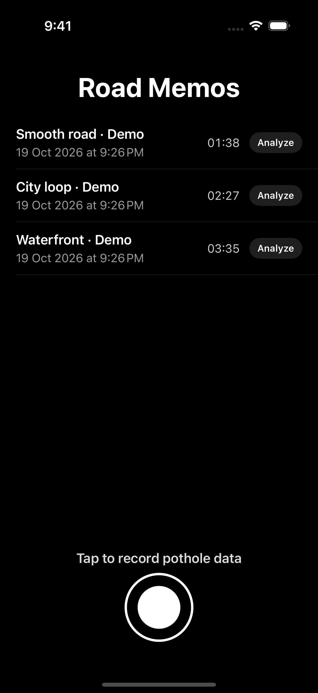
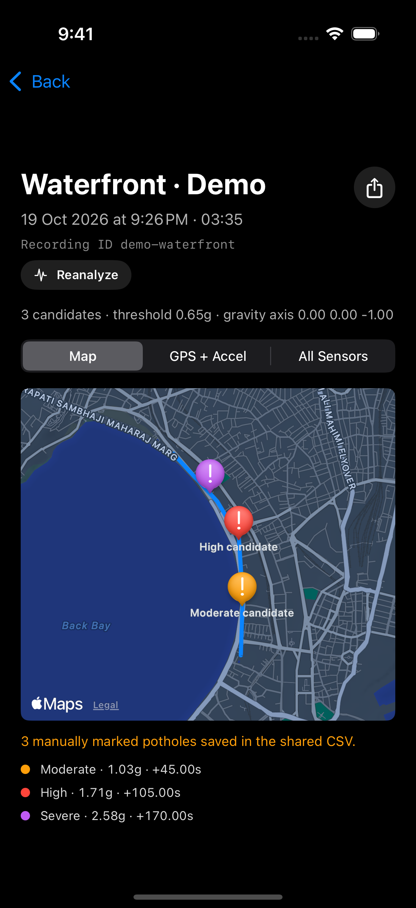
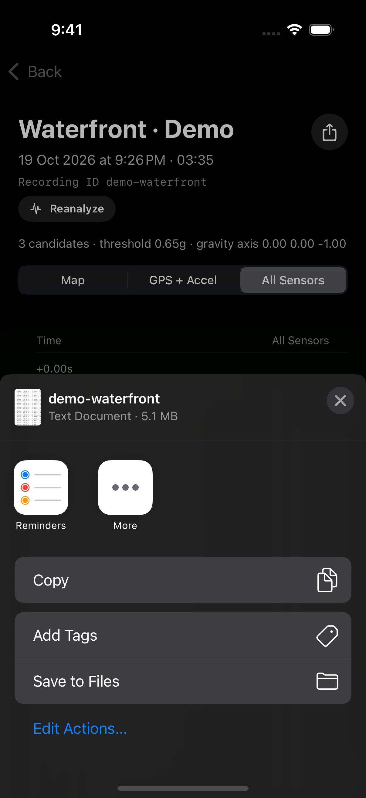
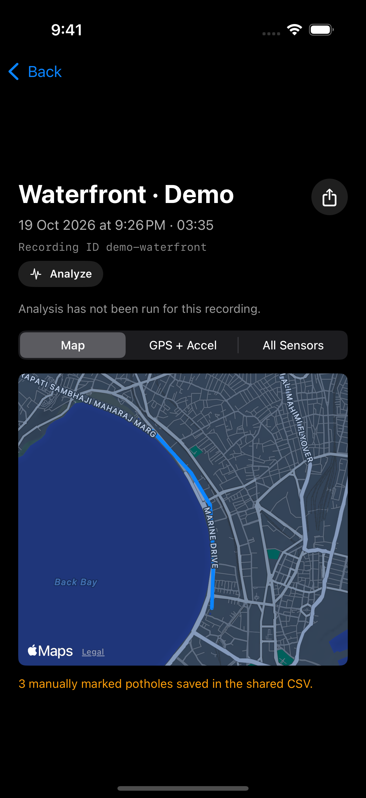
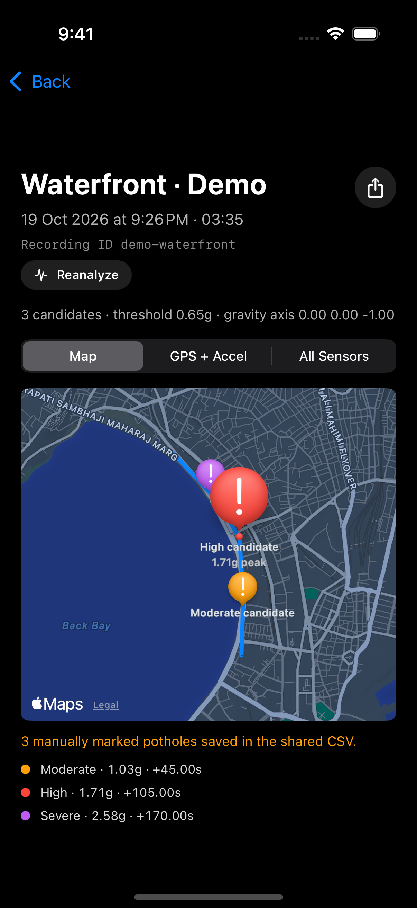
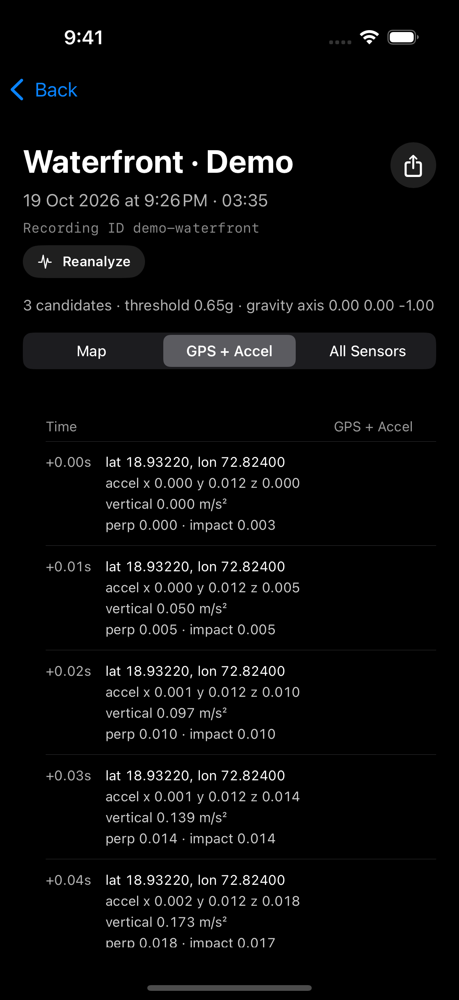
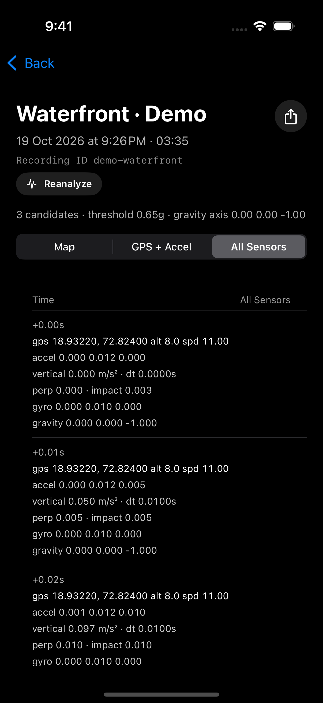
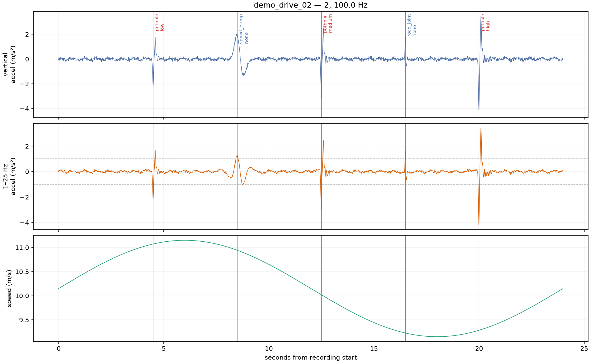

# Pothole Map · Road Memos

**Turn a mounted iPhone into a road-impact recorder.** Record a drive, review where
the car felt a bump, and share the motion + GPS data for closer analysis.

Road Memos is useful for surveying a stretch of road, investigating a rough ride,
or collecting a dataset for pothole-detection research. A passenger can mark a
suspected pothole during a recording; after the drive, you can inspect the route
and run an on-device analysis to highlight possible impacts.

**Record a drive → review impact candidates → inspect the evidence → export CSV.**

## See the app in action

These are screenshots of the running iPhone app, using **synthetic demo recordings**.
The routes, passenger markers, and impact values illustrate the workflow; they are
not reports of real potholes. Tap any screenshot to see it at full size.

<table>
  <tr>
    <th width="33%">1. Keep your drives together</th>
    <th width="33%">2. Find impacts along a route</th>
    <th width="33%">3. Take the data with you</th>
  </tr>
  <tr>
    <td valign="top"><a href="docs/screenshots/01-recordings.png"></a></td>
    <td valign="top"><a href="docs/screenshots/03-impact-candidates.png"></a></td>
    <td valign="top"><a href="docs/screenshots/07-share-csv.png"></a></td>
  </tr>
  <tr>
    <td valign="top">Start and stop with the large record button. Each saved drive has a date and duration, ready to open or analyze.</td>
    <td valign="top">Run <strong>Analyze</strong> to see possible impacts on your route, with their impact category, acceleration peak, and time.</td>
    <td valign="top">Share a recording as a CSV or save it to Files, then use it for a road survey or an offline experiment.</td>
  </tr>
</table>

## Explore a recording

<table>
  <tr>
    <th width="50%">Review the drive and passenger markers</th>
    <th width="50%">Inspect an individual candidate</th>
  </tr>
  <tr>
    <td valign="top"><a href="docs/screenshots/02-recorded-route.png"></a></td>
    <td valign="top"><a href="docs/screenshots/04-candidate-detail.png"></a></td>
  </tr>
  <tr>
    <td valign="top">Open a saved drive to see where you went. A passenger's <strong>Mark Pothole</strong> taps are saved as approximate timestamps in the CSV; the detail view shows how many were marked.</td>
    <td valign="top">Tap a colored pin to inspect its category and peak acceleration. Orange, red, and purple distinguish <strong>Moderate</strong>, <strong>High</strong>, and <strong>Severe</strong> impacts.</td>
  </tr>
  <tr>
    <th>Check location alongside acceleration</th>
    <th>Look at the underlying sensor readings</th>
  </tr>
  <tr>
    <td valign="top"><a href="docs/screenshots/05-gps-acceleration.png"></a></td>
    <td valign="top"><a href="docs/screenshots/06-all-sensors.png"></a></td>
  </tr>
  <tr>
    <td valign="top">Use <strong>GPS + Accel</strong> to browse each sample's location and acceleration, with elapsed time and the analysis's impact score.</td>
    <td valign="top">Use <strong>All Sensors</strong> for the full context: speed, acceleration, gyroscope, gravity, and the time between motion samples.</td>
  </tr>
</table>

The pins are **impact candidates**, not confirmed potholes or measurements of
pothole depth. Speed bumps, road joints, and phone movement can also cause impacts.
Passenger markers and sensor evidence help you decide what to review.

## Continue the investigation on your computer

The Python companion turns exported recordings into plots like this one. Inspect
the raw and filtered acceleration alongside vehicle speed, compare candidate
impacts with reviewed labels, and distinguish potholes from other bumps.

[](docs/screenshots/08-offline-waveform.png)

*Actual output from the experiment CLI's deterministic synthetic demo. This plot
illustrates the review workflow; it does not establish real-world detection accuracy.*

## Tools in this repository

This repository contains two connected tools:

- **Road Memos**, a SwiftUI iPhone app that records versioned Core Motion and GPS
  datasets from a rigid phone holder; and
- **pothole-exp**, a reproducible Python CLI for validating recordings, plotting
  signals, proposing candidate impacts, editing labels, extracting features, and
  evaluating a grouped classical-ML baseline.

The intended first loop is: record on iPhone → share CSV → validate and plot → label
candidates → rerun the baseline.

## Install Road Memos on an iPhone

Requirements: macOS with Xcode, an iPhone running iOS 16 or later, and an Apple
development team selected in Xcode.

1. In **Xcode → Settings → Accounts**, add your Apple ID. Select its team, open
   **Manage Certificates**, and create an **Apple Development** certificate if none
   exists.
2. Open `accelsensordatarecording.xcodeproj`.
3. Select the `accelsensordatarecording` target, open **Signing & Capabilities**, and
   select your development team if Xcode asks.
4. Connect and unlock the iPhone, trust the Mac, and select the phone as the run
   destination.
5. Press **Run**. Grant Location and Motion & Fitness permission on first use.
6. Secure the phone in its holder before driving. Start and stop only while parked.
7. During a recording, a passenger may press **Mark pothole** to add an approximate
   event timestamp. The driver must not operate the app while moving.
8. Stop the recording, open it from the list, and use the share button to AirDrop or
   save the CSV.

The app keeps the screen awake while recording, reports missing motion/GPS data,
shows the recorded route, and can run a transparent on-device candidate detector.
On-device candidates are exploratory; create reviewed labels with the offline tools
before treating them as potholes.

Before collecting a real dataset, complete the parked and road smoke tests in
[docs/DATA_COLLECTION.md](docs/DATA_COLLECTION.md). Copy
[docs/session_manifest_template.csv](docs/session_manifest_template.csv) into your
dataset and fill one row per recording.

## Recorded data

New recordings use CSV schema version 2. A single shareable file contains:

- `sensor` rows requested at 100 Hz;
- sparse `event` rows created by **Mark pothole**;
- monotonic `motion_time_s`, Unix `wall_time_unix_s`, and measured
  `motion_delta_s`;
- user acceleration, rotation rate, gravity, attitude quaternion, and a
  gravity-projected `vertical_accel_mps2` that is independent of holder orientation;
- GPS timestamp, age, validity, accuracy, speed, and course; and
- recording, device, OS, app, schema, and target-rate metadata.

The filename and recording detail screen expose the same `recording_id` stored in
the CSV, so it can be copied directly into the session manifest.

GPS fixes are asynchronous and slower than motion updates. Repeated coordinates are
expected; use `location_valid`, `gps_timestamp_unix_s`, and `gps_age_s` to judge them.
Unavailable fields are blank instead of being disguised as zeros.

The app and Python loader remain compatible with the original 14-column CSV format.
The old format can still be explored, but it cannot recover GPS age/accuracy or true
monotonic sensor timing that was never recorded.

## Run the experiment workflow

[`uv`](https://docs.astral.sh/uv/) manages the Python version and dependencies. From
the repository root:

```bash
cd experiments
uv sync
uv run pothole-exp demo-data demo
uv run pothole-exp inspect demo/recordings
uv run pothole-exp run demo/recordings --labels demo/labels.csv --out demo/results
```

The deterministic demo contains both legacy and version-2 recordings, potholes, and
hard negatives. It exercises loading, validation, filtering, candidate detection,
label matching, feature extraction, plotting, group-aware training, and metrics
without requiring phone data.

For recordings exported from the phone:

```bash
cd experiments
uv run pothole-exp inspect /path/to/recordings
uv run pothole-exp run /path/to/recordings --out results
```

The first unlabeled run creates `results/labels_to_edit.csv`. Inspect the plots and
fill `is_pothole` explicitly with `1` or `0`; also fill `event_type`, `severity`, and
notes where useful. Blank labels remain unknown and are never silently converted to
negative examples. Then run:

```bash
uv run pothole-exp run /path/to/recordings \
  --labels results/labels_to_edit.csv \
  --out results-labelled
```

Phone event markers are matched to nearby candidates with an auditable time offset.
The default tolerance is one second to allow for passenger reaction time and can be
overridden from the CLI. Confirm markers against video or the waveform before using
them as ground truth.

Run the Python test suite with:

```bash
cd experiments
uv run pytest
```

## Interpreting the baseline

The detector uses gravity-projected vertical acceleration, a band-pass filter, and a
robust adaptive threshold to propose transient impacts. A random forest then uses
window features such as peaks, RMS, jerk, frequency-band energy, gyroscope energy,
and speed.

Training and evaluation are split by complete `recording_id`, not by random sensor
windows. This prevents neighboring samples from the same drive leaking into both
sets. The current baseline evaluates classification among detected candidates; it
does not by itself prove that every pothole was detected. Measure candidate recall
against fully reviewed drives before tuning only for classifier scores.

Phone acceleration measures vehicle impact, not pothole depth. Vehicle suspension,
tires, speed, wheel path, load, and holder flex all affect amplitude. Use `low`,
`medium`, and `high` as perceived impact severity unless a defect was independently
and safely measured.

## Project layout

```text
accelsensordatarecording/       iPhone recorder and on-device inspection
accelsensordatarecordingTests/  Swift CSV/analyzer compatibility tests
experiments/                    Python CLI, tests, and reproducible environment
docs/                           collection protocol and manifest template
```

## Troubleshooting

- **No motion samples:** enable Motion & Fitness access under **Settings → Privacy &
  Security → Motion & Fitness**, then restart the app.
- **No route/GPS:** enable location access for Road Memos and retry outdoors after GPS
  settles. Motion-only files are still saved and clearly marked as lacking GPS.
- **Signing error:** select your own team and, if needed, change the bundle identifier
  to a value unique to that team. `security find-identity -v -p codesigning` should
  report at least one valid Apple Development identity before a command-line signed
  build can succeed.
- **Device unavailable in Xcode:** unlock it, reconnect the cable or enable wireless
  debugging, and confirm that the Mac is trusted.
- **CoreMotion.plist console warning:** check Motion & Fitness permission and any MDM
  restrictions. Reinstall after changing permissions.
